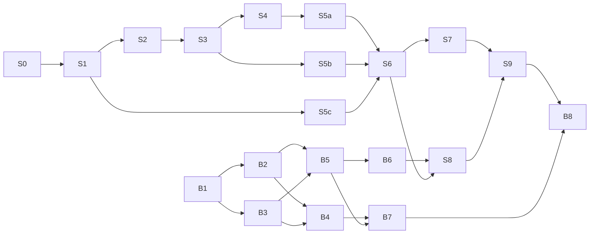

# 작은 단계별 개발 계획 초안

근거: P19, R5·6·10·12·13. 단계 분해는 설계 제안입니다. 현재 기본 뼈대와 입력·업로드 단계만 구현했습니다. 이후 단계도 사용자 요청에 따라 독립 PR·테스트·완료 증거를 남깁니다. 선택 기능은 핵심 단계 실패를 가리지 않습니다.

확정 우선순위: **상품 이미지 업로드 → AI 광고 4종 생성 → 선호도 순위 표시 → 문구 수정 → PNG 다운로드**. 자료 충돌 시 최종 발표본을 적용합니다. D01·D04·D07·D08은 사용자 승인 완료이며 A4는 PNG MVP 이후 OPTIONAL, 최종 필수 완료 조건 제외입니다.

## 서비스 트랙 A

이번 feat/service-upload 범위: S2의 세션·이미지 검증·비공개 원본 저장·24시간 정리·pending draft 저장/재조회와 입력 UI. 사용자 승인으로 PUT /jobs/{job_id}/input을 추가했고 GET의 동일 draft 응답으로 재조회합니다. 실제 광고 POST /jobs·processing pipeline·JobStatus polling은 다음 기능에 남겨 S2 전체 완료로 보고하지 않습니다. 매장 localStorage 프로필·배경 제거·모델은 이번 범위가 아닙니다.

| 단계 | 독립 산출물 | 의존 | 테스트·완료 기준 |
| --- | --- | --- | --- |
| S0 문서 승인 | 요구·계약·결정 기록 | 없음 | D01·D04·D07·D08 승인 반영 완료, D09–12와 A/B input 상세 리뷰. 미확정 부분은 초안 유지 |
| S1 skeleton·계약 fixture | React/Vite·FastAPI health, Pydantic/OpenAPI, types·lock·CI | S0 | 양쪽 PC README 실행, health·schema·4후보 fixture, .gitignore 코드/raw 경로 확인 |
| S2 안전 upload·session·job | 비공개 단일 서버·Polling·고유 ID·24시간 삭제 | S1, 확정 D07–08 및 D09 수치 | 상태 네 값, 형식/크기·decode·안전 파일명·root/path·다른 session 검증. 원본/중간/성공·실패 결과 TTL·orphan 정리, 재시작 유실 안내. 클라우드/복잡한 큐 없음 |
| S3 사진 처리 | 보존 원본·배경 제거·비율 유지 resize | S2, 확정 D04 | 원본 hash 동일·색 보정 없음, 실패/상품 손상·품질 저하 fallback·원본 선택·네 후보 재렌더링. segmentation sample 수동 QA |
| S4 사진 분석 | CLIP zero-shot cue·K-means palette | S3 | 작은 fixture·seed·중립 fallback, 추정 cue를 사실 필드로 쓰지 않음 |
| S5a copy provider | structured JSON·facts binding | S1, S4 context fixture, D10 | fake provider 성공·잘못된 JSON·누락/중복 전략·사실 침범·retry. 유료 API는 opt-in |
| S5b 네 template·renderer | PNG·metadata·한글 fonts | S3, copy fixture, D11 | 전략별 geometry·문자 동일·font ready·overflow. LLM 없이 fixture로 독립 검증 |
| S5c MockRanker | 고정 score·정렬·source | S1 fixture | 네 ID·동점 정책·finite·mock 표시. B model 없이 실행 |
| S6 사용자 전체 흐름 | 입력→4 cards→copy edit→PNG | S2,S5a/b/c, D13 | 편집 시 LLM 재호출 없음·전체 rerank·revision 충돌·download, 모델 없이 E2E |
| S7 프로필·readability | localStorage·rule diagnostics | S5b,S6 | 저장 금지 browser에서도 생성, reset, 대비·bbox 계산·측정불가 null·rank와 분리. 가독성 통합은 발표 기준 Week 8 |
| S8 RealRanker adapter | B package load·output validation | S6,B6 | 정상·잘못된 ID/NaN/version·timeout·전체 mock fallback, 동일 UI schema |
| S9 통합·demo | 두 PC·배포·사용성 검증 | S7,S8 | 10개 이상 입력 E2E, 권한·한글·실패·최신 download, 모델 version freeze, 데모 2–3개+백업 |
| E1 A4 PDF OPTIONAL | print 전용 layout, 필수 완료 제외 | PNG MVP 완료 후 선택 작업 | 선택 시 1 page·210×297mm·한글·사실 동일·overflow, PNG 늘이기 금지 |
| E2 UMSI | saliency extension | S7, 명시적 선택 | 실제 inference·version·unavailable, 측정 아닌 모델 추정 표시 |

S4 분석 연결 전 S5a는 mock context, S5b는 고정 copy로 독립 개발할 수 있습니다. 전체 연결은 의존 충족 후 수행합니다. ranker mock과 문구 fake는 별도 설정입니다.

## 모델 트랙 B

A가 B 코드를 구현·수정하는 작업 지시가 아니라 B의 독립 산출물과 접점 계획입니다.

| 단계 | 산출물 | 의존 | 완료 기준 |
| --- | --- | --- | --- |
| B1 데이터 접근·manifest | CreativeRanking/TASTE 형식·조건·샘플 | 없음 | 실제 다운로드·라이선스 확인, raw Git 제외. 발표의 접근 가능 주장을 확인 실적으로 오해하지 않음 |
| B2 pair·split | same-product CTR / designer vote 정규화 | B1 | 방향·impression/CTR gap config·70/15/15 group 누수 검사·split manifest |
| B3 features | frozen CLIP ViT-L/14+통계 cache | B1 | sample ad folder CLI, feature 순서·전처리·version·seed, A PNG smoke |
| B4 baseline | Random/LAION/rule/양방향 LLM judge | B2,B3 | 동일 held-out pairs·공정 비교·비용/실패 기록 |
| B5 shared linear scorer | Bradley–Terry logistic v1 | B2,B3 | BCE·같은 scorer·finite scalar·validation 기록. MLP는 validation 개선 때만 선택 |
| B6 inference artifact | load/extract/score/rank surface | B5 | model/scaler/config·checksum·feature spec·error·sample smoke, A 없이 4 PNG 정렬 |
| B7 최종 평가 | metrics·95% bootstrap CI·model card | B4,B5, frozen model | unseen group test만 최종 보고. GT/tie/CI 단위와 Top-1/Kendall 계산 가능 조건 명시 |
| B8 도메인·사용성 분석 | owner 선택 비교·실패 사례 | S9,B7 | 긍정·부정 결과 모두 보고. food-ad test는 선택이며 학습에 사용하지 않음 |

Designer agreement는 자료에서 계산 가능한 범위의 reference이며 서비스 score의 신뢰구간이 아닙니다. 평가 성능 기준 숫자를 새로 만들지 않습니다. Mock 테스트는 B7을 대체하지 않습니다.

## 의존관계와 통합 게이트

A/B 병렬 개발과 S5c mock→S6 서비스 흐름→B6/S8 실제 모델 연결의 상세 점검은 [MODEL_HANDOFF](MODEL_HANDOFF.md)를 따릅니다. 현재 mock/전체 흐름은 미구현입니다. S9의 S8 의존과 말미의 모델 unavailable 시 서비스 완료 표현 사이 완료 경계는 공동 리뷰 사항으로 남기며 이번에는 계획을 변경하지 않습니다.

## 원본 일정과 현재 상태

날짜는 원본 계획(2026년)의 목표이며 달성 보고가 아닙니다. 2026-10-12 현재 기본 뼈대 및 입력·업로드·draft 조회·24시간 원본 정리를 구현했습니다. S1의 네 후보 fixture/타입 생성과 S2의 광고 JobStatus polling은 후속이며 전체 단계 완료로 보지 않습니다. S3 이후 이미지 처리·광고 기능은 미구현입니다.

| 주차·날짜 | A 목표 | B 목표 | 게이트 |
| --- | --- | --- | --- |
| Week 5 10/6–10/12 | repo·skeleton·upload·photo processing | 접근·형식·pair/split 계약 | candidate/ranking input 합의, mock와 dummy scoring |
| Week 6 10/13–10/19 | copy·4 templates·renderer | pair·feature·baseline | A PNG 20–40장 feature smoke·output 합의 |
| Week 7 10/20–10/26 | mock MVP·편집·PNG | logistic·validation·LLM judge | frozen v1 artifact·local integration smoke |
| Week 8 10/27–11/2 | real ranking·readability 진단, A4 OPTIONAL | test·95% CI·model card | 10개 이상 E2E·version freeze. A4 미구현이어도 필수 완료 가능 |
| Week 9 11/3–11/9 | user test·bug·배포·demo | owner choice 비교·실패 분석 | release candidate·두 PC 실행·백업 demo |

현재 초안 작성 때문에 원본 일정의 Week 5 목표가 자동 충족되지 않습니다. 승인 후 실제 진척과 가용 시간을 반영해 일정을 조정합니다.

## 각 작업 단위의 Git 절차

1. GitHub Flow로 main을 안정적인 통합 브랜치로 유지합니다. 현재 브랜치·Git 상태·원격·기존 PR을 확인하고 같은 작업 브랜치를 이어서 사용합니다. 새 기능 브랜치는 feat/, fix/, refactor/, test/, docs/, chore/로 구분합니다. develop은 만들지 않고 현재 feat/service-foundation을 보존합니다.
2. 의미 있는 작은 단위로 구현하고 관련 테스트를 통과한 뒤 메시지를 붙여 commit합니다. 실패한 단위는 수정·재검증하고, 문서 단위는 링크·일관성·공백을 검사합니다.
3. 기능 작업 완료 후 현재 브랜치를 push하고 main 대상 PR을 생성합니다. 같은 작업의 PR이 있으면 갱신하며 완료 작업을 중복 실행하지 않습니다.
4. 영어 Conventional Commits 메시지로 commit하며 PR 제목도 Conventional Commits로 작성합니다. PR 템플릿에 목적·구현·변경 파일·테스트·Issue·화면 변경 스크린샷·확인 사항을 기록합니다. 사용자 검토와 명시적 승인 전 merge하지 않습니다.
5. main 직접 commit/push, force push, 다른 사람의 변경 덮어쓰기를 금지합니다. API 키·실제 .env·임시 파일·개인정보는 commit하지 않습니다.

사용자의 지속적인 Git 지시에 따라 이 절차를 수행하되 새로운 계정 권한·main 보호 적용·기존 브랜치 삭제는 사전 승인을 받습니다. 기존 커밋을 다시 쓰지 않습니다. CI에 repository-policy 검사도 포함합니다. 상세 절차는 [CONTRIBUTING.md](../CONTRIBUTING.md), Codex 규칙은 [AGENTS.md](../AGENTS.md)를 따릅니다.

## 단계별 공통 완료 기준

변경 범위와 소유자 확인, 합의된 계약 유지, 재현 명령·결과 기록, 비밀/데이터 제외, 서비스 불변 규칙 검사, PR 리뷰가 필요합니다. 유료 API·원본 upload는 승인된 시험 자료만 사용합니다. 배포·동의·비용 결정 전 실사용 운영을 시작하지 않습니다. 실제 모델 unavailable일 때 서비스 완료를 유지하되 최종 모델 연구 완료와는 구분합니다.
