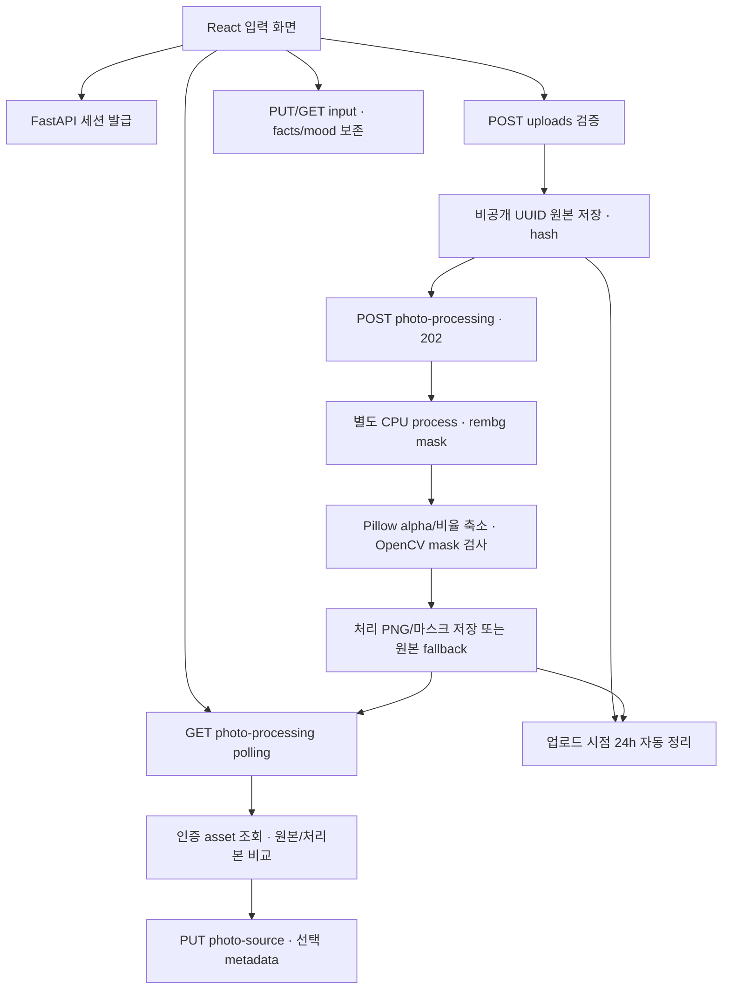

# Hanjang 개발 완료 현황

기준: 2026-10-24 main `cc2fbbc`(PR #15 병합). 이 문서는 구현/계약/계획을 구분합니다. 오늘은 문서·현황 검증만 수행하며 6단계 이미지 분석이나 B 코드 변경은 하지 않습니다.

## 1–5단계 완료 범위

아래 번호는 서비스 개발 가이드 순서이며 DEVELOPMENT_PLAN의 S0/S1… 번호와 다릅니다. “완료”는 현재 승인된 작은 범위에 대한 판정이며 전체 광고 서비스 완료가 아닙니다.

| 단계 | 현재 판정 | 근거/남은 경계 |
| --- | --- | --- |
| 1 개발 환경·Git·설계 | 기본 구성 완료 | pin/lock, GitHub Flow, CI, 계약 fixture/검증. B 환경은 PR #13 미병합 |
| 2 프론트엔드 기본 화면 | 완료 | React·연결 상태·재시도·입력·비교 UI, 타입/Vitest/build/E2E 검증 |
| 3 FastAPI 기본 서버 | 완료 | health·CORS·설정 분리·공통 오류·API 회귀 검사 |
| 4 상품 정보·이미지 업로드 | 승인 범위 완료 | session·실제 이미지 검증·원본/draft 저장·조회·접근 보호·24h 정리 |
| 5 rembg/Pillow/OpenCV | 승인 범위 완료 | 배경 제거·비율 유지 축소·비교·원본/처리본 선택·실패 fallback. 실제 상품 품질은 수동 QA 필요 |

S1 네 후보 fixture/Schema는 완료지만 frontend OpenAPI 자동 타입 생성은 없습니다. S2 광고 JobStatus polling과 S3의 향후 네 광고 재렌더링은 미구현입니다. 원본 일정 날짜를 달성 근거로 사용하지 않습니다.

## main 반영과 PR

| PR | 상태/반영 |
| --- | --- |
| #11 | MERGED, main merge `7312bff`: 전처리 API·UI·CPU 의존성·검증 |
| #14 | MERGED, `21ea54e`: photo/ranking 설정 공존, artifacts/models/ 정책, 데이터 권리 미확인 |
| #15 | MERGED, `cc2fbbc`: v1.1 계약·합성 fixture·Schema·integration 38개 |
| #13 | OPEN: B의 ML 환경. 이번에 수정·병합하지 않음 |

이 현황 정리 문서 자체는 docs/development-status 브랜치의 별도 PR로 검토합니다. 자동 merge하지 않습니다. 현재 main Ruleset은 PR 필수·삭제/force push 금지이지만 필수 CI/리뷰 승인 1건은 미지정이라는 기존 점검 결과를 유지합니다. CI 성공과 서버 측 강제를 혼동하지 않습니다.

## 현재 구조

```text
frontend/src/App.tsx                  연결 상태와 서비스 입력 화면
frontend/src/components/             ProductInput, PhotoProcessing
frontend/src/api/                    health, uploads, photos client
frontend/e2e/                        Playwright 정상/예외·모바일
backend/app/main.py                  app factory·CORS·sweep
backend/app/config.py                photo·ranking 설정
backend/app/api/                     health/uploads/photos/errors/limits
backend/app/schemas/                 health/upload/photo 실제 API
backend/app/services/                private store, processor, process worker
tests/service/                      실제 서비스 회귀 57개
tests/integration/                  문서 계약 전용 검증 38개
tests/fixtures/ads/                  합성 RGB 광고 4장
tests/fixtures/contracts/            Candidate/Ranking JSON과 Schema
scripts/service_*                   저장소 검사·명시적 모델 준비·fixture 생성
docs/                               제품/기술/계약/역할/검증
```

ml/·tests/ml/는 B PR의 별도 영역이며 현재 main에는 없습니다. ml_adapter·광고 templates도 후속입니다. 계약 테스트용 모델은 실제 serving/추론 구현이 아닙니다.

## 실제 API와 화면

기본 prefix는 /api/v1입니다. 세션 발급/health 외 보호 API는 X-Hanjang-Session을 사용합니다.

| API | 역할 |
| --- | --- |
| GET /health, GET /api/v1/health | 연결 확인, v1-draft 응답. 광고 준비 완료를 의미하지 않음 |
| POST /sessions | 비공개 작업 세션 발급 |
| POST /uploads | photo multipart 1장, 원본 asset·pending job 생성 |
| PUT·GET /jobs/{job_id}/input | facts/mood draft 저장·재조회, 광고 생성 없음 |
| GET /assets/{asset_id} | 자기 원본/처리본 bytes, 공개 static 경로 아님 |
| POST /jobs/{job_id}/photo-processing | 202, 별도 사진 처리 시작 |
| GET /jobs/{job_id}/photo-processing | 처리 상태·경고·asset·선택 조회 |
| PUT /jobs/{job_id}/photo-source | original/processed 선택 저장, 광고 재생성 없음 |

UI는 연결 상태, 상품 사진/가게명/상품명/가격/분위기 입력, 저장/재조회, 배경 제거 상태, 원본/처리본 비교·선택을 제공합니다. JPG/PNG·10MiB·24MP·양변 최소256px, 이름80자/가격40자 제한을 유지합니다. 사실 문자열은 trim·가격 변환 없이 보존합니다.

## 데이터 흐름



브라우저 파일 미리보기는 로컬 object URL입니다. 서버에는 사용자 파일명을 경로로 쓰지 않고 원본 bytes를 저장합니다. React가 facts/mood를 별도로 저장하고 GET으로 확인합니다. 전처리 요청은 광고 생성과 별개이며 rembg는 mask만 제공하고 RGB는 원본에서 취합니다. 색 보정·재생성·crop·upscale 없이 배경 alpha와 비율 유지 축소만 적용합니다.

실패/모델 부재/timeout 또는 품질 경고 시 원본을 기본 선택합니다. 경고 없는 성공도 원본 선택이 가능합니다. 선택은 metadata만 바꾸며 원본을 덮어쓰지 않습니다. 업로드 시점 24시간 TTL을 조회/선택으로 연장하지 않습니다. draft pending과 사진 operation의 pending/processing/completed/failed는 서로 다릅니다.

## 모델·데이터 관리와 A/B 경계

모델·학습 산출물 root는 artifacts/models/입니다. 전처리 u2netp 기본 경로는 artifacts/models/rembg/u2netp.onnx입니다. 공식 모델 약4.36MiB는 명시적 준비 명령만 다운로드하며 런타임은 자동 다운로드하지 않습니다. RANKING_MODEL_PATH는 미래 B 모델 **파일**을 가리키며 현재는 선택적 설정만 존재합니다. directory loader와 manifest 규칙은 B와 합의해야 합니다.

Evan12/CreativeRanking은 후보입니다. HF card의 apache-2.0 표기는 확인했지만 원본 동일성·원본 라이선스·재배포/이용 권한은 미검증입니다. raw는 /data/ 또는 datasets/, 코드 ml/data/와 구분합니다. 데이터/가중치를 소스 Git에 넣지 않습니다. 자세한 근거는 [정책](MODEL_STORAGE_AND_DATASET.md)을 따릅니다.

A는 frontend/backend 서비스·전처리·renderer·adapter 통합을, B는 데이터·학습·평가·feature/scaler·추론을 소유합니다. A는 B label/split/metric/feature 순서를 수정하지 않습니다. [v1.1](RANKING_CONTRACT_V1_1.md)은 최종 광고 1080×1350 RGB, open_clip_torch, 비율 유지 padding, 네 후보 batch와 ID 유지·model/feature version·선택적 pairwise를 정의합니다. 이는 계약이며 실제 광고/MockRanker/RealRanker 엔진은 없습니다. Mock은 임의 확률을 생성하지 않고 preference는 구매/CTR/매출 예측이 아닙니다. ViT-L/14·768차원은 기본 모델로 확정하지 않습니다.

## Windows 새 PC 실행

[README Windows 절차](../README.md#새-데스크탑노트북에서-clone)와 아래 순서를 따릅니다. 현재 설치 조건은 Git·GitHub 인증·Python3.12·Node24(npm)입니다. 계정 로그인은 각자 직접 승인합니다.

```powershell
gh auth login --hostname github.com --git-protocol https --web
gh auth setup-git
git clone https://github.com/Noah3507/hanjang.git
cd hanjang
git status --short --branch
py -3.12 -m venv .venv
.\.venv\Scripts\python.exe -m pip install -r backend/requirements.txt
npm.cmd --prefix frontend ci
if (!(Test-Path .env)) { Copy-Item .env.example .env }
if (!(Test-Path frontend/.env)) { Copy-Item frontend/.env.example frontend/.env }
# 선택 사항: 공식 rembg 모델 명시적 준비. 없어도 원본 fallback 사용 가능.
.\.venv\Scripts\python.exe scripts/service_download_photo_model.py --download
# 터미널 1
.\.venv\Scripts\python.exe -m uvicorn app.main:app --app-dir backend --reload --host 127.0.0.1 --port 8000
# 별도 터미널 2, 같은 저장소 루트
npm.cmd --prefix frontend run dev
```

기본 UI http://127.0.0.1:5173, Swagger http://127.0.0.1:8000/docs입니다. localhost는 현재 PC만 의미합니다. 실행 중인 포트를 임의 종료하지 않습니다. main에서 소스 변경/commit/push하지 않고 새 작업은 별도 브랜치에서 시작합니다. 서비스 .venv와 B .venv-ml/의존성을 합치지 않습니다.

루트 .env는 서버 전용(CORS, HANJANG_PHOTO_*, 선택적 RANKING_MODEL_PATH), frontend/.env는 공개 VITE_API_BASE_URL과 proxy DEV_BACKEND_URL입니다. 키는 현재 필요 없고 VITE_*에 비밀을 넣지 않습니다. 기존 env는 덮어쓰지 않습니다. 현재 CPU 의존성 rembg2.0.77/Pillow12.3.0/OpenCV4.13.0.92 등은 backend/requirements.txt로 설치합니다.

## 로컬 파일 감사: Git으로 전달되지 않는 것

| 항목 | 점검/준비 |
| --- | --- |
| 실제 .env, frontend/.env | 존재·변수 이름만 확인, 값은 보고/commit하지 않음. 각 PC에서 example로 구성 |
| .venv, node_modules, dist, cache | 로컬 존재, lock/requirements로 재생성. 원격 백업 대상 아님 |
| u2netp.onnx | 주 작업 폴더 artifacts/models/rembg/에 4,574,861 bytes, Git 제외. 새 PC는 명시적 준비 |
| uploads, artifacts·보고서/로그 | 비공개 runtime/테스트 파일, Git 제외. 사용자 원본은 Git 백업이 아님 |
| references의 발표 PDF/DOCX | 두 원본은 미추적 로컬 자료. 이번에 /references/ ignore 보강, 원본 내용/위치는 변경하지 않음. 필요 시 승인된 별도 방식으로 전달/백업 |
| tmp 아래 worktree | 로컬 별도 checkout. 디렉터리는 제외돼도 각 브랜치의 commit/push는 GitHub에 존재 |

점검 시 다른 기존 worktree는 clean이며 이번 문서 변경 외 미커밋 소스를 발견하지 못했습니다. 원래 IDE 루트는 이전 feat/service-upload에 남아 있으므로 그 화면을 최신 main과 혼동하지 않습니다. 기존 작업을 자동 전환/삭제하지 않았습니다. 새 clone은 최신 main에서 실행하면 됩니다. 미저장 소스·stash는 다른 PC에 전달되지 않으므로 작업 시작/종료 시 status·fetch/pull --ff-only·검증·commit/push를 확인합니다.

## 테스트와 확인 방법

이번 최신 main 검증: Windows Python3.12에서 전체 pytest 95개, 계약 별도38개, pip check, TypeScript, Vitest14개, build가 통과했습니다. 최신 main Actions run 40098348849도 성공했습니다. 계약 검증은 모델/네트워크 없이 JSON/Schema·합성 RGB만 사용합니다. B Mac ML5개 통과는 B의 보고이며 Ubuntu/Windows ML 검증 실적으로 바꾸지 않습니다. ML CI job은 제안 단계입니다.

실행 명령:

```powershell
.\.venv\Scripts\python.exe -m pytest
.\.venv\Scripts\python.exe -m pytest tests/integration -q
npm.cmd --prefix frontend run typecheck
npm.cmd --prefix frontend run test:ci
npm.cmd --prefix frontend run build
```

Playwright는 설치된 Chrome 또는 별도 Chromium이 필요합니다. [README 브라우저 테스트](../README.md#실제-브라우저-자동-테스트)를 따릅니다. 이번 Windows Chrome 실행은 14개가 통과했습니다(20.1초). 실제 API 업로드·draft 조회·기존 u2netp 배경 제거·원본/처리본 선택과 모의 장애·모바일 검사를 구분했습니다. 모델 필수 옵션으로 실행했고 신규 모델/데이터 다운로드는 없었습니다. 실제 상품 segmentation 품질 인증은 아닙니다. 결과는 이 작업 worktree의 artifacts/playwright/report/index.html과 results.json에 있습니다.

이번 확인용 서버는 http://127.0.0.1:5178 (React), http://127.0.0.1:8006/docs (FastAPI)로 실행했습니다. 기본 설치 안내의 5173/8000과 구분하며 프로세스는 재부팅 후 자동 유지되지 않습니다.

직접 확인: 사진·정보 입력→저장/재조회→배경 제거→상태 완료/경고→윤곽·누락 비교→원본 사용/처리본 사용→다시 조회. 모델 없는 환경에서는 원본 경고와 선택 유지가 기대 결과입니다.

## 미구현과 남은 위험

CLIP zero-shot/K-means 사진 분석, LLM copy, 실제 네 광고 renderer, MockRanker/실모델 adapter, 광고 생성/polling, 문구 편집·전체 rerank·PNG 다운로드, 프로필/readability, 배포는 미구현입니다. fixture PNG는 다운로드 기능 산출물이 아닙니다. A4 PDF와 saliency는 OPTIONAL입니다.

마스크의 상품 일부 손상은 휴리스틱으로 완전히 검출하지 못합니다. 단일 동시 처리·90초 기본 제한·cold load, 24h 파일 삭제, 재시작 metadata 유실이 있습니다. 실제 배포 메모리/latency·권한/백업은 별도 검토가 필요합니다. AnyIO deprecation과 Actions 런타임/runner 이미지 전환 경고가 남아 있습니다. 비밀 스캐너는 모든 PII/키 탐지를 보장하지 않습니다.

## 다음 6단계 시작 조건 — 오늘 구현하지 않음

1. 최신 main/브랜치/PR을 확인하고 별도 이미지 분석 브랜치에서 시작합니다. 이 문서 PR은 사용자 리뷰 후 병합합니다. B PR #13은 별도로 B 수정·검토합니다.
2. 원본/처리본 중 분석 입력, alpha와 배경 제외·색 공간·palette/K-means seed·유효 pixel 처리와 중립 fallback을 합의합니다. 사용자 사실을 추정 결과로 덮어쓰지 않습니다.
3. open_clip_torch 우선 방향을 유지하되 서비스·ML Pillow 충돌을 고려해 의존성/프로세스 격리를 결정합니다. encoder/가중치/입력 크기·정규화·padding·CPU 메모리/시간은 검증 후 결정합니다.
4. 내부 분석 context와 새 API 필요 여부를 먼저 제안하고 계약 변경은 사용자 승인 후 적용합니다. B ranking feature/scaler/전처리를 복제하지 않습니다.
5. 모델 다운로드/외부 비용은 opt-in으로 승인받고 권리 확인된 fixture를 준비합니다. fake CLIP과 고정 seed·합성 색 검증부터 시작하며 실제 추론 시험과 구분합니다.
