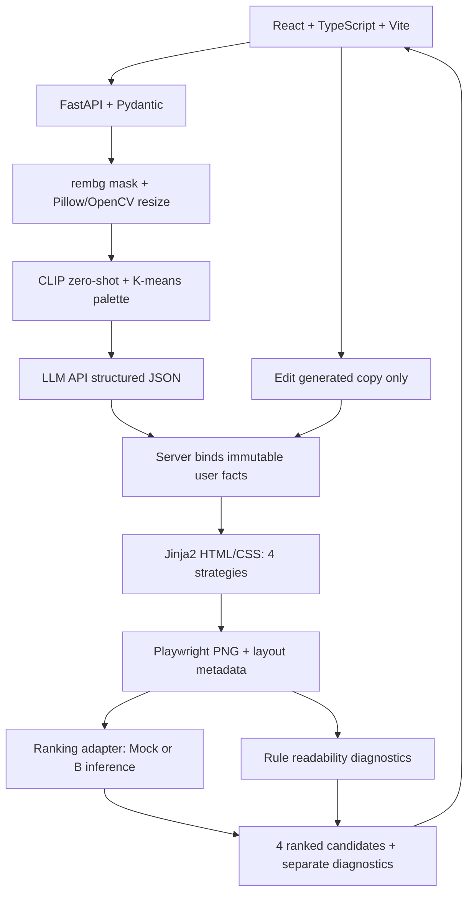

# Hanjang 기술 설계 초안

기술 선택의 근거는 P11·12·16, R3·4·5·8입니다. P/R 표기는 [결정 목록](REQUIREMENTS_REVIEW.md)을 따릅니다. 자료 충돌 시 최종 발표본을 우선합니다. 현재 health·입력·업로드·draft·사진 전처리/선택과 임시 파일 정리를 구현했고 광고 파이프라인은 후속입니다. 단일 서버·비공개 임시 저장·24시간 삭제·Job Polling과 사진 처리 경계는 사용자 확정이며 timeout·cache는 제안입니다.

## 연결 구조

현재 구현 경로는 React → Vite /api proxy → FastAPI health 및 세션/원본 업로드/draft 입력/재조회입니다. PrivateUploadStore는 메모리 메타데이터와 uploads/originals/의 원본 byte를 연결합니다. middleware는 인증·요청 크기를 multipart 파싱 전에 확인하고 Pillow는 decode 검증만 수행합니다. 입력은 PUT/GET draft API로 저장·조회하며 POST /jobs는 미구현입니다. 아래 광고 파이프라인은 후속 설계입니다.

세션 token hash와 생성 asset/job UUID로 소유권을 검사합니다. 저장 파일은 서버 이름·검증된 root 하위이며 client 파일명/path를 쓰지 않습니다. 원본은 재인코딩하지 않고 SHA-256을 기록합니다. upload_root는 서버 전용 HANJANG_UPLOAD_ROOT로 변경 가능하며 전용 비공개·Git 제외 경로만 사용해야 합니다. 기본은 uploads/originals/입니다.

lifespan의 시작 정리·60초 sweep은 만료 원본과 draft metadata를 제거합니다. 조회·입력 수정은 업로드 TTL을 연장하지 않습니다. 서버 재시작 후 memory 세션/draft는 유실될 수 있고 disk orphan은 24시간 후 시작/sweep에서 정리됩니다. CORS에는 POST/PUT 및 X-Hanjang-Session을 추가하되 명시 origin·credentials=false·loopback 바인딩을 유지합니다. 루트 .env/프론트 공개 환경의 분리는 그대로입니다.

편집은 기존 후보의 문구만 교체하며 사진 처리·LLM 생성을 다시 실행하지 않습니다. 수정 후 네 후보 전체를 같은 scorer로 재정렬합니다.

## 컴포넌트 경계

| 컴포넌트 | 입력→출력 | 책임 |
| --- | --- | --- |
| frontend | form→API, job→cards/editor/download | A. OpenAPI 기반 타입, 서버 비밀키 접근 금지 |
| FastAPI/Pydantic | multipart/JSON→validated job state | A. 허용 field·enum·길이·소유권·revision 검증 |
| photo processor | original→mask/processed photo/transform | A. 원본 보관·해시·decode 제한·재생성 금지 |
| photo analysis | photo→category cue/palette | A. CLIP zero-shot 분류 힌트, K-means 색 추출. B ranking 특징과 별개 |
| copy provider | facts/mood/cue→4 copy objects | A. JSON 검증·retry·사실 침범 검사. facts를 LLM 결과에서 가져오지 않음 |
| renderer | facts/copy/photo/template→PNG/metadata | A. Jinja2 escaping·고정 assets·Playwright fonts ready |
| diagnostics | metadata/PNG→rule measurements | A. font·contrast·overlap, 시선 예측과 구분 |
| adapter | 최종 PNG 4장→scores/ranks | A. Mock/Real 전환·B 응답 검증·fallback |
| B inference | 최종 PNG→frozen CLIP/statistics→shared scorer | B. model/scaler/config/feature version 일치 |
| export | 최신 완료 revision→PNG, MVP 이후 선택 PDF | A. 안전한 asset ID 해석·소유권 검사. A4는 최종 필수 조건 제외 |

## 원본과 사실 입력 보존

원본 파일을 덮어쓰지 않고 SHA-256과 변환 이력을 기록합니다. MVP에서 허용하는 상품 사진 처리는 배경 제거와 원본 비율 유지 리사이즈뿐입니다. 상품 자체의 색상·채도·명도 보정은 보류하며 생성·재해석·형태 변경을 금지합니다. 템플릿 배경 합성은 사진과 별도 레이어로 수행합니다. EXIF 방향은 표시 해석에만 적용합니다. resize 출력 pixel byte는 달라지므로 보존을 byte 동일성으로 잘못 설명하지 않습니다.

처리본은 원본과 다른 asset으로 보관합니다. 실패·빈/비정상 mask·상품 손상 의심 또는 품질 저하 시 원본 프레임으로 fallback하고 warning을 기록합니다. 품질 threshold는 아직 제안 단계이며 자동 검사만으로 부분 손상을 완전히 판별하지 못합니다. 처리 미리보기와 원본 사용 선택을 제공하고, 원본 선택 시 새 사진 처리 없이 네 후보를 원본으로 재렌더링·재순위화하는 설계를 제안합니다. 원본 선택 UI/API 상세는 S3 계약 리뷰에서 고정합니다.

facts는 수락한 문자열을 불변값으로 보관하고 copy JSON과 분리합니다. 자동 trim·숫자 변환을 금지하고 공백만 입력·제어 문자·길이 초과는 거부합니다. LLM은 headline/body/CTA만 반환하며 사실은 서버가 템플릿 전용 영역에 직접 연결합니다. 금지된 사실 주장이나 입력 사실 변경을 통과시키지 않습니다.

HTML을 입력받지 않고 plain text를 escape합니다. frontend는 dangerouslySetInnerHTML을 사용하지 않는 방침입니다. 분석 category는 추정 힌트이며 상품명 교체·성분·효능의 근거가 아닙니다. brand 전략도 미입력 로고를 생성하지 않습니다.

## 확정 Job 방식과 편집 제안

API는 202 job을 반환하고 frontend가 polling합니다. 작업 상태는 `pending`→`processing`→`completed` 또는 `failed`만 사용합니다. stage는 photo_processing/photo_analysis/copy_generation/rendering/ranking/diagnostics이며 state와 분리합니다. 초기에는 순차 처리하며 가짜 진행률을 표시하지 않습니다. 별도 취소 상태·취소 endpoint는 MVP에 넣지 않습니다.

초기 운영은 단일 서버·비공개 임시 disk·로컬 job 관리로 확정합니다. 한 프로세스/worker 구성은 구현 제안입니다. 무거운 작업은 HTTP event loop와 분리하며 별도 클라우드 스토리지나 복잡한 작업 큐를 도입하지 않습니다. JobStore, AssetStore, JobExecutor 인터페이스를 분리해 추후 영속 저장·외부 executor로 교체할 수 있게 합니다. 서버 재시작·배포 시 작업 및 파일이 유실될 수 있으므로 재조회 불가·재업로드 안내를 제공합니다. 영속성과 재시작 복구를 MVP 완료 조건으로 보장하지 않습니다.

편집 중 이전 완료본을 보존하고 성공 시 candidate render와 전체 ranking을 새 revision으로 함께 공개합니다. 실패 시 이전 완료본을 유지합니다. candidate/job/ranking revision을 맞춰 새 이미지에 이전 점수를 붙이지 않습니다. 낙관적 잠금 불일치는 409입니다.

## Mock/Real ranking

MockRanker는 R10 예시에 따라 visual=0.8, emotional=0.6, price=0.4, brand=0.2 고정값을 제안합니다. 학습된 선호도가 아닌 UI 검증용입니다. API source=mock/model_version=mock-v1, UI는 '데모 순위'로 표시합니다.

RealRanker는 B package를 한 번 load하고 **최종 렌더링 PNG**를 평가합니다. 상품 cutout만 평가하지 않습니다. strategy는 추적 metadata이며 학습 feature가 아닙니다. B의 승인된 CLIP encoder·통계 순서·scaler·전처리를 A가 재구현하지 않습니다. A 사진 분석 CLIP은 별도 책임이며 모델 버전·전처리가 같다고 가정하지 않습니다.

4 ID 완전 일치, finite score, model/feature version, rank 정합을 검증합니다. 실패 시 네 후보 전체 mock fallback과 warning을 반환합니다. mock/real 점수를 섞거나 readability를 preference에 더하지 않습니다. 10초 timeout은 D14 제안이며 cold start 포함 여부·실측 후 B와 합의합니다. 로컬 inference timeout 격리는 별도 실행 경계에서 구현하고 단순 thread 취소로 작업 종료를 보장하지 않습니다.

cache key 제안: rendered_image_sha256+model_version+feature_version+preprocessing_version. 다른 이미지·모델 점수는 재사용하지 않습니다. 모델 upload 기능을 제공하지 않고 B가 전달한 신뢰된 artifact만 load합니다.

## Renderer와 진단

네 템플릿은 동일 facts·원본 유래 사진을 사용하며 [DESIGN_SPEC](DESIGN_SPEC.md)의 geometry를 바꿉니다. fonts/image decode ready, 고정 viewport, versioned font/template, animation 비활성으로 PNG를 만듭니다. K-means seed를 고정하고 편집은 저장된 copy를 재사용합니다. 새로운 LLM 호출까지 매번 같은 문구를 만들 것이라고 보장하지 않습니다.

metadata: canvas, 모든 text/product bbox, font size/weight, 전경·배경색, 줄 수, overflow, template version. 복잡한 사진 배경에서 대비 측정 불가면 null입니다. layout order는 geometry 추정이며 시선 측정이 아닙니다. UMSI는 선택 확장이고 구현·검증 전 attention/visibility 예측을 반환하지 않습니다.

A4는 PNG MVP 이후 OPTIONAL이며 최종 필수 완료 조건에서 제외합니다. 나중에 선택 구현 시 별도 print layout을 Playwright PDF로 출력하는 안입니다. PNG를 늘리지 않고 210×297mm·여백·폰트·한글·페이지 넘침을 검증합니다. PNG 순위가 A4에서도 유효하다고 보장하지 않습니다.

## 운영·보안 경계 제안

- 작업별 고유 job ID로 원본·중간 파일·결과물을 묶습니다. 경로 제안은 uploads/<session>/<job>/<asset_id>와 artifacts/rendered/<job>/<revision>이며 실제 경로를 client에 노출하지 않습니다. 업로드 단계의 asset도 pending job에 귀속하는 상세 계약을 아래 API 문서와 맞춥니다.
- 크기·허용 형식·실제 decode 검증을 수행하고 서버 생성 파일명만 저장합니다. resolved path가 지정된 저장 root 내부인지 확인하고 traversal·절대경로·symlink 우회를 거부합니다. 사용자 파일명은 경로로 사용하지 않습니다.
- opaque session token으로 API·download를 보호합니다. 예측 어려운 ID만으로 인증을 생략하지 않습니다. 임의 URL fetch·directory listing 금지.
- 24시간 자동 삭제는 확정입니다. job.created_at 기준 expires_at을 설정하고 원본·중간 파일·결과물·관련 cache를 모두 삭제합니다. 실패 파일·미완성 upload도 생성 후 24시간 내 정리합니다. 주기적 sweep과 시작 시 orphan 정리를 제안하며, 만료 후 조회는 즉시 차단하고 다음 sweep에서 물리 삭제합니다. 실행 중에도 TTL을 연장하지 않고 만료 작업의 추가 쓰기를 차단합니다. 서버 중단 중에는 삭제 실행을 보장할 수 없으므로 재시작 시 우선 정리합니다.
- 원본은 보관 기간 동안 덮어쓰지 않습니다. 이는 영구 보관과 별개입니다. 원본 학습 재사용 금지, 입력 text·이미지·키를 log하지 않습니다.
- LLM key는 서버 .env, frontend VITE_*에 비밀 금지. 초기 외부 전송은 text/context만 제안하며 이미지 전송은 하지 않습니다.
- Playwright 외부 network를 차단하고 관리된 local assets/fonts만 허용합니다. 사용자 script·file URL 주입 금지.
- dev는 localhost+Vite proxy. 공개 배포 전 HTTPS·origin 제한·rate limit·storage 용량을 합의합니다.
- B artifact는 Git 밖, checksum·feature spec·model card는 Git 관리. 의존성 lock·Windows/Linux smoke는 S1에서 확인합니다.

재시작·배포 유실은 승인된 캡스톤 MVP 한계입니다. 클라우드 스토리지·복잡한 큐는 도입하지 않으며 Render 배포 환경·LLM 공급자·공개 접근 방식의 세부 사항은 남은 결정입니다. 핵심 우선순위는 업로드→AI 광고 4종→선호 순위→문구 수정→PNG입니다.

## 공식 기술 문서 확인

저장소 협업은 [CONTRIBUTING.md](../CONTRIBUTING.md)의 GitHub Flow·Conventional Commits를 따릅니다. CI의 repository-policy는 stage/index 파일·흔한 비밀 패턴·PR 제목을 검증하고 기존 backend/frontend 검사와 함께 실행합니다. 이는 모델 API 계약·A/B 소유권·제품 범위를 바꾸지 않습니다. main 보호 적용·새 권한·브랜치 삭제는 사용자 사전 승인 대상이며 자동 merge·force push는 수행하지 않습니다.

파일 upload를 JSON job 요청과 별도 endpoint로 나눈 것은 [FastAPI 파일 요청 문서](https://fastapi.tiangolo.com/tutorial/request-files/)의 multipart/JSON 구분에 맞춘 설계 제안입니다. HTML escaping은 [Jinja API 문서](https://jinja.palletsprojects.com/en/stable/api/)의 autoescape 설정을 명시적으로 활성화해야 합니다. rembg는 [공식 저장소](https://github.com/danielgatis/rembg)의 배경 제거 도구이며 이미지 생성 도구로 사용하지 않습니다. PNG·PDF 렌더링은 [Playwright Python Page 문서](https://playwright.dev/python/docs/api/class-page)의 screenshot/pdf 기능을 기준으로 구현합니다. 이 확인은 원본 요구사항이나 라이브러리 호환성 smoke test를 대신하지 않습니다.

## S3 사진 전처리 구현

배경 제거, 비율 유지 축소, 원본/처리본 비교와 사진 선택 API를 추가했습니다. 실행 설정과 계약은 [IMAGE_PROCESSING](IMAGE_PROCESSING.md)를 따릅니다. 모델이 없으면 자동 다운로드 없이 원본 fallback을 사용합니다. 광고 재생성 및 후속 분석/LLM/ranking은 미구현이며 S3의 향후 네 후보 재렌더링까지 완료했다고 보고하지 않습니다.

## 2026-10-24 모델 저장 및 데이터 후보 협의

기본 모델/학습 산출물 root는 artifacts/models/이며 신규 backend/models/ 저장은 사용하지 않습니다. RANKING_MODEL_PATH는 선택적 모델 파일 설정입니다. Evan12/CreativeRanking은 후보이며 원본 동일성/라이선스/이용 권한은 미검증입니다. 배치 방법과 loader 경계 차이는 [MODEL_STORAGE_AND_DATASET](MODEL_STORAGE_AND_DATASET.md)를 따릅니다. 이번 변경은 실제 ranking을 구현하지 않습니다.

## 2026-10-24 모델 연동 계약 승인

확정된 출력/추론/예제와 미확정 bundle·배포 항목은 [RANKING_CONTRACT_V1_1](RANKING_CONTRACT_V1_1.md)을 따릅니다. PR 점검과 B 수정 요청·ML CI 계획은 [ML_PR_REVIEW](ML_PR_REVIEW.md)에 정리합니다. 이번은 문서·fixture·경량 검증이며 MockRanker 또는 실제 모델 기능을 구현하지 않습니다.
# 2026-10-28 S4 구현 추가

A 전용 `.venv-analysis`·고정 requirements에서 OpenCLIP ViT-B-32/OpenAI 로컬 가중치를 CPU QuickGELU로 실행합니다. 서비스 .venv/rembg와 B .venv-ml은 변경하지 않습니다. 장기 실행 단일 subprocess·text embedding cache·요청ID 검증·hard timeout·idle 종료를 사용합니다. K-means는 서비스의 기존 NumPy로 수행해 CLIP 환경이 없어도 동작합니다. 비공개 Job/asset snapshot·24h TTL·is_current gate와 [IMAGE_ANALYSIS](IMAGE_ANALYSIS.md)의 API/운영 경계를 따릅니다. 아래 광고 생성 파이프라인은 여전히 후속입니다.
## 2026-10-28 S5a 구현 추가

CopyStore는 upload Record에 입력·사진·현재 CLIP payload·생성 설정의 fingerprint와 카피를 보관하고 기존 TTL과 소유권을 재사용합니다. 기본 Mock, Pydantic·사실 검사, 사진 분석 worker와 독립된 HTTP background 작업을 추가합니다. OpenAI SDK/Responses adapter는 준비했지만 실제 호출 gate는 false이며 계정 접근과 네트워크 성공은 미검증입니다. 서비스 requirements에 SDK를 추가하며 B·분석 환경은 변경하지 않습니다. [COPY_GENERATION](COPY_GENERATION.md)의 전송 제한·캐시·재시도·비용 원장·한계를 따릅니다. 사진 직접 전송은 미승인·미구현입니다.
## 2026-10-28 S5b 실행 구조

기존 서비스 .venv에 Jinja2/MarkupSafe를 추가하며 Node24와 frontend에 고정된 Playwright Chromium을 subprocess에서 재사용합니다. torch/open_clip/B 환경은 변경하지 않습니다. 서버가 trusted 템플릿·폰트·현재 asset bytes를 바인딩하고 네 PNG를 atomic publish합니다. 추가 측정은 Candidate 외부 envelope, 진단 수치는unavailable/null입니다. 상세 보안·timeout·snapshot·설치는 [RENDERING](RENDERING.md)을 따릅니다.
